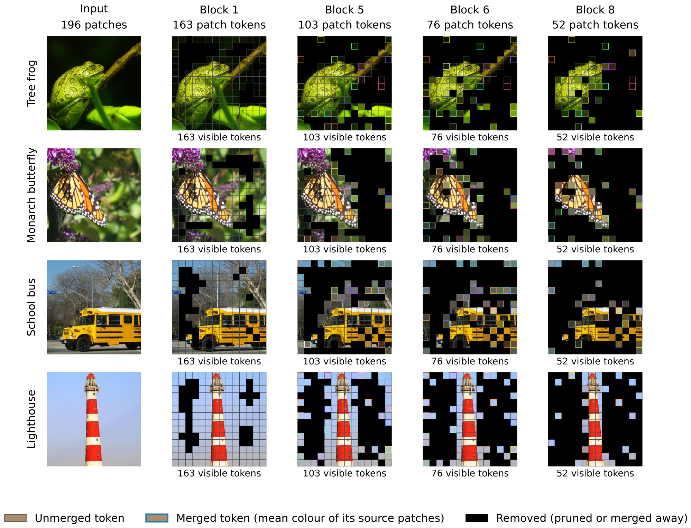
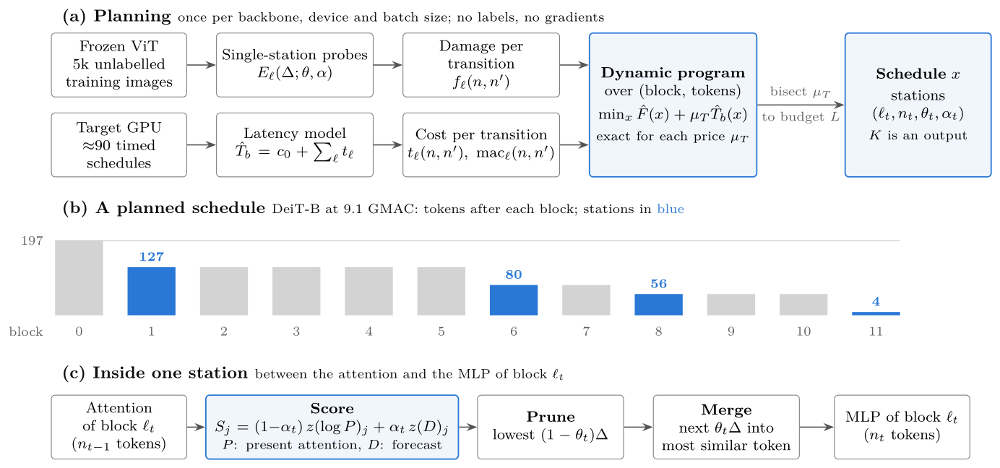
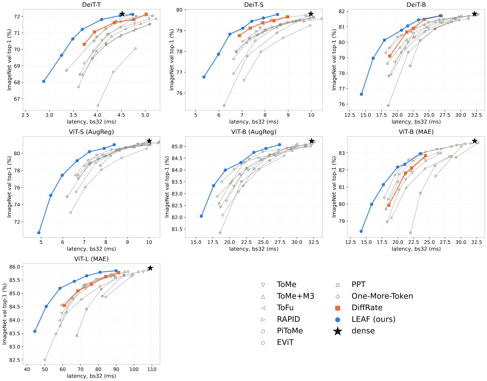

# LEAF: Latency-Budgeted Efficient Planning with Attention Forecasts for Training-Free Token Reduction

LEAF speeds up a **frozen** Vision Transformer by removing tokens between blocks. Nothing is trained or fine-tuned.
For a given backbone, device and latency budget, it plans the whole token schedule:
- **where** to reduce (which blocks);
- **how many** tokens to keep;
- **how** to remove them (the share pruned rather than merged);
- **which** tokens to remove (how much the score trusts a forecast of future attention).

Planning is a Lagrangian dynamic program over measured single-station probes and a station-aware latency estimate. Once the probes exist, it takes seconds.

This repository holds the method (`leaf/`), every schedule and configuration that the paper evaluated (`schedules/`, `assets/schedules/`) and the paper's per-image results (`release/`), so that each number of the paper can be re-evaluated and the whole pipeline re-run. The manuscript is under review at *Knowledge-Based Systems*; see [Citation](#citation).



*From an image to a planned token schedule.* LEAF on DeiT-B at a 10-GMAC budget (actual cost: 9.93 GMAC) chooses an initial pruning station followed by three merging stations. Columns show the input and all stations before the final block; counts exclude the class token. Each surviving token is drawn as one square at its representative position: an unmerged token shows its original patch, and a merged token shows the mean image colour of all its source patches inside a coloured border. Every other position, whether pruned or merged into another token, is black, so the number of squares equals the number of tokens and falls from 163 to 52. The final post-attention station is omitted here but executed and included in the cost. Source membership is traced as in DiffRate and ToMe; the squares show membership, not decoded features.



*LEAF at a glance.* **(a)** The planner probes one station at a time on unlabelled images and fits a latency model on the target GPU. Both estimates add up over blocks, so a dynamic program finds the schedule that best trades damage for latency, and bisection on the latency price meets the budget. **(b)** A schedule fixes the blocks that host stations and the number of tokens kept after each. **(c)** Each station scores tokens by present attention plus a forecast of future attention, and removes Δ = n<sub>t−1</sub> − n<sub>t</sub> tokens before the block's MLP: it prunes the lowest-scoring (1 − θ<sub>t</sub>)Δ and merges the next θ<sub>t</sub>Δ (rounded) into the most similar kept tokens.

## Contents
- [Method in brief](#method-in-brief)
- [Results](#results)
- [Installation](#installation)
- [Data preparation](#data-preparation)
- [Use a released schedule](#use-a-released-schedule)
- [Plan schedules for a new budget, device or backbone](#plan-schedules-for-a-new-budget-device-or-backbone)
- [Reproduce the paper](#reproduce-the-paper)
- [Command reference](#command-reference)
- [Repository layout](#repository-layout)
- [Names used in files and results](#names-used-in-files-and-results)
- [Tests](#tests)
- [Limitations](#limitations)
- [Provenance and acknowledgements](#provenance-and-acknowledgements)
- [Citation](#citation)
- [License](#license)

## Method in brief

**Station.** A station sits between the attention and the MLP of a block. It:
1. scores the patch tokens;
2. prunes the lowest-scoring ones;
3. merges a further share θ of the removed tokens into their most similar kept tokens.

The merge is the norm-preserving MLERP rule (M3), and attention is proportional to token size. The class token is never removed.

**Score.** A station ranks tokens by

```
S_j = (1 - α) · z(log P_j) + α · z(D_j),        α ∈ {0, 1/4, 1/3, 1/2, 2/3, 3/4, 1}
```

- `P` is the present class-token attention (the EViT criterion).
- `D` forecasts the class-token attention that later blocks will pay, by applying the query-key maps of all later blocks to the current tokens.
- `D` is made cheap in three steps:
  1. folding the weights (exact);
  2. grouping similar heads, G = 16 (an approximation);
  3. truncating to rank r = 32 (an approximation).

  Two Triton kernels then compute it in at most 51 µs per station at batch 32.

**Planner.**
1. **Probes.** On 5,000 unlabelled training images, LEAF measures the KL divergence to the dense model of every single station: block, number of removed tokens, θ ∈ {0, ½, 1} and α. That is 1,917 probes for a 12-block model. Incremental differences of these curves give a distortion surrogate that is separable along depth.
2. **SALT.** The station-aware latency estimate is a non-negative linear model over per-block GMAC and per-station launch and traffic features. It is fitted to about 30–50 timed workloads on the target device and batch size.
3. **Lagrangian DP.** For each latency price, an exact dynamic program over (block, token count) states minimises distortion plus priced time; the number of stations comes out of the solution. A bisection on the price meets the budget, and a final rescaling of the keep ratios uses the remaining slack.

All shapes are fixed per schedule, so a planned model runs as one CUDA graph.

## Results

Every method was re-run on the same weights, data pipeline and BF16 precision. Latency is measured on one NVIDIA RTX 5060 Ti at batch 32 as one CUDA graph, as the mean of three interleaved rounds in one session per backbone.

**DeiT-B** (dense: 81.83 val / 70.95 V2, 32.2 ms). LEAF is planned under 0.97 × the measured latency of each released DiffRate schedule.

| Budget | Method | GMAC | ms ↓ | ImageNet val ↑ | ImageNet-V2 ↑ |
|---|---|---:|---:|---:|---:|
| DR8.7 | DiffRate | 8.74 | 18.81 | 79.11 | 67.44 |
| | **LEAF** | 9.00 | **17.97** | **80.14** | **68.56** |
| DR10.0 | DiffRate | 9.99 | 21.49 | 80.66 | 69.40 |
| | **LEAF** | 10.30 | **20.67** | **80.78** | **69.45** |
| DR11.5 | DiffRate | 11.53 | 24.26 | **81.48** | **70.76** |
| | **LEAF** | 11.64 | **23.34** | 81.44 | 70.15 |
| DR12.5 | DiffRate | 12.53 | 26.91 | 81.71 | 71.01 |
| | **LEAF** | 13.11 | **26.77** | 81.71 | 71.00 |

The paper covers seven backbones (DeiT-T/S/B, ViT-S/B AugReg, MAE ViT-B/L) and 48 budgets, against ten re-run families: DiffRate, ToMe, ToMe+MLERP (`ToMe+M3` in file names), PiToMe, EViT, PPT, MCTF, ToFu, Pruning One More Token and RAPID (MCTF is slower than the dense model, so nine families have latency-matched points).
- At equal measured latency, LEAF is significantly more accurate than the re-run method in 64 of 68 pairs on ImageNet val (McNemar, Holm-corrected) and never significantly less accurate; it dominates 7 of the 24 released DiffRate schedules.
- At equal GMAC it uses 4–8 stations where DiffRate uses 9–22 and is faster in 22 of 24 pairs.
- Where latency departs from FLOPs, planning by measured latency beats planning by GMAC in all 12 batch-32 pairs on a Tesla T4 (only SALT refitted) and by up to 2.3 points on a CPU.
- With the same code and settings on CLIP ViT-B/16, LEAF wins all 43 latency pairs on zero-shot accuracy, improves retrieval that the planner never sees, and is more accurate than DiffRate's own search on CLIP at equal latency.



The paper's schedules and their measured accuracy and latency are in two places:
- [`schedules/leaf/`](schedules/README.md): the method's released schedules;
- [`assets/schedules/`](assets/README.md): one book per backbone with **every schedule the paper evaluated**: LEAF, DiffRate and every re-run baseline point, ablation arms, other campaigns.

Every entry runs with `leaf evaluate` / `leaf benchmark`, and prints the paper's number next to yours (see [Reproduce the paper](#reproduce-the-paper)). More figures are in [`assets/`](assets/README.md).

## Installation

Tested with Python 3.12, PyTorch 2.14 (CUDA 13.0), timm 1.0.30 and Triton (bundled with PyTorch), on Linux with an NVIDIA RTX 5060 Ti.

```bash
git clone https://github.com/huynhcanhvien/LEAF.git leaf && cd leaf
python -m venv .venv && source .venv/bin/activate
pip install torch torchvision --index-url https://download.pytorch.org/whl/cu130
pip install -e .                     # the `leaf` package and command
cp .env.example .env                 # HF_TOKEN, only for downloading ImageNet
```

Every command can be run as `leaf <command>` or as `python -m leaf <command>` from the repository root. `leaf backbones` lists the backbones and the names every `--backbone` accepts (`deit_b`, `deit-b`, `DeiT-B` or the timm id); the list is `leaf/backbones.json`, and `LEAF_BACKBONES=my_backbones.json` adds your own. Commands that read `data/` and `schedules/` use paths relative to the repository root, so run them from there. Symbolic links are fine, for example `ln -s /big/disk/cache data/cache`.

## Data preparation

All splits are decoded once into uint8 memory maps (Resize 256 bicubic → CenterCrop 224) under `data/cache/`. Normalisation happens on the GPU for each backbone.

```bash
leaf data download                               # ImageNet-1k WebDataset shards (timm/imagenet-1k-wds) -> data/imagenet_tar
leaf data prepare --split val                      # 50,000 validation images
leaf data prepare --split calib_bal                # 10 images/class from train shards 900-999; even indices = the 5,000 probe images
leaf data prepare --split calib                    # first 10k images of train shards 1000+; the first 1,024 are used for head grouping
leaf data prepare --split confirm                  # train shards 1008-1023 (confirmation set of the paper's protocol)
leaf data prepare --split v2 --v2-tar imagenetv2-matched-frequency.tar.gz
```

The planner uses training images only. To download ImageNet, accept the ImageNet licence on Hugging Face first. ImageNet-ReaL labels are included in `data/real/`.

## Use a released schedule

```bash
leaf schedules schedules/leaf/deit_b.json                                  # stations, budget, measured latency and accuracy
CUDA_VISIBLE_DEVICES=0 leaf evaluate  --schedule schedules/leaf/deit_b.json --key latency/DR10.0 --split val
CUDA_VISIBLE_DEVICES=0 leaf benchmark --schedule schedules/leaf/deit_b.json --key latency/DR10.0 --batches 1 32 128
CUDA_VISIBLE_DEVICES=0 leaf benchmark --backbone deit_b --dense                # reference in the same session
```

`leaf evaluate` reproduces the released accuracy exactly. On DeiT-T `latency/DR0.8` it gives the same per-image predictions on all 50,000 validation images as the paper. Latency depends on the device: the released budgets hold on an RTX 5060 Ti at batch 32.

```python
from leaf.api import load_schedule, LeafRunner
from leaf.latency.timing import measure_latency
doc, entry = load_schedule('schedules/leaf/deit_b.json', 'latency/DR10.0')
runner = LeafRunner('deit_b', root='runs/leaf/deit_b', timm_id=doc['timm_id'])   # batch 32, data/cache
arr = runner.run(entry['config'], 'val')                                       # per-image correct / pred / KL
print(100 * arr['correct'].mean(), measure_latency(runner.inference_model(entry['config']), 32)['ms_mean'])
```

## Plan schedules for a new budget, device or backbone

**A new budget on the paper's setup** (CPU, seconds). `--budgets` with the released `budgets.json` reproduces every released schedule exactly.

```bash
P=schedules/leaf/planning/deit_b
leaf plan --backbone deit_b --probes $P/probes.json --groups $P/groups.json --salt $P/salt.json --budget-ms 19.5 --out runs/plans/deit_b.json
leaf plan --backbone deit_b --probes $P/probes.json --groups $P/groups.json --gmac 9.0 --out runs/plans/deit_b_gmac.json
```

**A new device or batch size.** The probes do not depend on the device, so only the timed workloads and the SALT fit are redone:

```bash
CUDA_VISIBLE_DEVICES=0 leaf time-workloads --backbone deit_b --batch 8 --workloads $P/salt_workloads.json --out runs/salt/deit_b_bs8.json
leaf fit-latency --backbone deit_b --timings runs/salt/deit_b_bs8.json --out runs/salt/deit_b_bs8_model.json
leaf plan --backbone deit_b --probes $P/probes.json --groups $P/groups.json --salt runs/salt/deit_b_bs8_model.json --budget-ms 6 --out runs/plans/deit_b_bs8.json
```

**A new backbone, GPU or grid: `leaf search`.** One command runs the whole search in a workspace folder:
- `group`: head groups of the forecast D;
- `probe`: single-station probes on 5,000 training images, sharded over the GPUs;
- `budgets`: anchor schedules timed on this GPU;
- `workloads`, `time`, `fit`: SALT fitted to timed workloads;
- `plan`: the Lagrangian DP at every budget.

```bash
leaf search --backbone deit_s --workspace runs/search/deit_s --gpus 0,1      # two GPUs: one probe shard per GPU
leaf search --backbone deit_s --workspace runs/search/deit_s --gpus 0        # one GPU
leaf search ... --dry-run                                                    # print the commands only
```

The workspace keeps every output:
- `groups.json`;
- `probes/`: a cache of every probe run, and `probes.json`;
- `budgets.json`;
- `salt_workloads.json`, `salt_timings.json` and `salt.json`;
- `schedules.json`, which works with `leaf schedules`, and with `leaf evaluate|benchmark --schedule`;
- `search.json`: the commands that were run.

A step whose output exists is skipped, so an interrupted search resumes where it stopped; `--redo STEP` runs a step again.

**Custom grids.**
- `--thetas` and `--alphas` set the planning grid (fractions such as `1/3` are allowed), and `--deltas` sets the probed token cuts.
- Probes are cached one by one in the workspace: rerunning with a larger grid probes only the new points.
- `leaf probe --prefix-cache` runs the blocks before the station once per block and reuses them for every probe at that block: the same results bit for bit (`tests/test_prefix_cache.py`), about 2.5–3× faster on a 24-block model; it keeps the tokens of the 5,000 images on the GPU (5.3 GB for CLIP ViT-L/14).
- `probes.json` keeps every grid probed in that workspace; the planner uses the grid of the current call.

**Budgets.** `leaf budgets` measures anchor schedules on this GPU (bs32, three interleaved rounds, each run warmed up) and derives the budgets as in the paper. `--anchors` chooses the anchors:
- `diffrate`: DiffRate's released schedule at each of its GMAC points, budget = 0.97 × its latency, plus `extra1` and `extra2` below the fastest. This is the default when DiffRate has schedules for the backbone.
- `dense`: fractions of the dense latency (the AugReg budgets). This is the default otherwise.
- `gmac --gmac-points 8 10 12`: LEAF schedules GMAC-planned at your points.
- `configs --anchor-configs FILE`: any configs.

`leaf search` also takes `--budgets FILE`, `--budget-ms ...` and `--gmac ...`.

**Latency model.**
- `leaf workloads` plans about 45 timing workloads from the probes: GMAC-planned schedules at eight GMAC points in five variants (M3, M0, no forecast, pruning only, merging only), plus DiffRate's schedules.
- `leaf time-workloads` times them, and `leaf fit-latency` fits SALT.
- `--salt FILE` reuses a model fitted on the same GPU; `--workloads FILE` times another set, for example the paper's `salt_workloads.json`.

**Timing protocol.** Probes may use every GPU. Timing steps (`budgets`, `time`) run on the first GPU of `--gpus` after the probes have finished, and every GPU command refuses a card that another process uses. Keep the machine free of other jobs while timing.

**Reusing the paper's probes.**
- The released probe tables (`schedules/leaf/planning/<bb>/probes.json`), head groups and SALT models let `leaf plan` reproduce every released schedule without a GPU (`schedules/README.md`); `leaf probe` measures the probes again.

The single steps are also commands (`leaf group-heads | probe | budgets | workloads | time-workloads | fit-latency | plan`); every one has `--help`.

**Other planning inputs of the paper.** `schedules/leaf/planning/<bb>/` also holds:
- `probes_m0.json`: probes with the M0 merge, for `leaf plan --operator M0`;
- `probes_seed251.json` and `probes_seed351.json`: other calibration draws, for DeiT-B, MAE-B and AugReg-S.

Planned with `--alphas 0 1/2 2/3 3/4`, they give the paper's M0-operator and calibration-seed ablation schedules exactly.

Backbones are defined in `leaf/backbones.py` (`SPECS`); a timm ViT with a class token needs one line. Every command has `--help`.

## Reproduce the paper

There are two ways to check the paper, from quick to complete. Both need the evaluation caches of [Data preparation](#data-preparation) (`val` and `v2`; CLIP also needs its text embeddings, see [CLIP](#clip-zero-shot-imagenet-and-image-text-retrieval); ViT-B/16 at 384 px needs a 384-px cache, see below).

### Option 1: re-evaluate the schedules of the paper

Every configuration that the paper evaluated, LEAF and baselines alike, is in the repository with its stations, token counts, settings and head groups:

| Experiments of the paper | Schedule file (`--schedule`) |
|---|---|
| Seven ImageNet classifiers: every arm of the main comparison, equal GMAC, ablations and pricing, with the paper's numbers | `assets/schedules/<bb>.json` (schedule books) |
| LEAF's released schedules (Table 2) and their planning inputs | `schedules/leaf/<bb>.json`, `schedules/leaf/planning/<bb>/` |
| Sealed arms of each campaign (baselines included) | `schedules/main_comparison_plans/`, `gmac_planned/`, `latency_pricing/`, `low_budget_and_factorial/`, `horizon_norm_seed_ablation/`, `leaf_m0/` |
| CLIP ViT-B/16, ViT-B/16 at 384 px, and the revision experiments | `schedules/journal/<experiment>/<bb>/plans*.json` |

```bash
leaf schedules assets/schedules/deit_b.json | grep main/diffrate              # list the arms and pick a key
CUDA_VISIBLE_DEVICES=0 leaf evaluate  --schedule assets/schedules/deit_b.json --key main/diffrate/DR8.7 --split val
# {"top1": 79.11, ..., "gmac": 8.7399, "paper_top1": 79.11}
CUDA_VISIBLE_DEVICES=0 leaf evaluate  --schedule assets/schedules/deit_b.json --key leaf/latency/DR8.7 --split v2
CUDA_VISIBLE_DEVICES=0 leaf benchmark --schedule assets/schedules/deit_b.json --key leaf/latency/DR8.7
# {"ms_mean": {"32": ...}, "paper_ms_bs32": 17.974}
CUDA_VISIBLE_DEVICES=0 leaf evaluate  --schedule schedules/journal/clip_comparison/clip_b16/plans.json --key leaf/latency/DR8.7 --split val
```

- **Accuracy** reproduces exactly (BF16, batch 32, deterministic kernels); schedule books print the paper's number next to the measured one.
- **GMAC** is printed by `leaf evaluate`: the analytic count of Supplementary S2 for LEAF and dense, and torch's FlopCounter on the built model for the baselines, as in the paper (run it on a GPU; on the CPU the attention products are not counted).
- **Latency** is the paper's on an RTX 5060 Ti with the machine otherwise idle; on the same card, expect it within a few percent. Keep other jobs off the GPU while timing.
- `paper` in each book entry names the tables and figures that use it. Sealed plan files (`plans*.json`) carry no numbers; their per-image results are in `release/` (below).

**ViT-B/16 at 384 px** (577 tokens) is registered separately so that the 224-px campaigns are unchanged: prefix the commands with `LEAF_BACKBONES=leaf/backbones_vitb384.json`, build its cache once with `leaf data prepare --split val --side 384 --crop-pct 1.0 --out-dir data/cache384` (and `--split v2`), and pass `--data-cache data/cache384`, for example `LEAF_BACKBONES=leaf/backbones_vitb384.json leaf evaluate --schedule schedules/leaf/augreg_b384.json --key latency/dense0.48 --split val --data-cache data/cache384`.

**Per-image results and statistics.** `release/LEAF_raw_results_v1.zip` (36 MB, CC BY 4.0) holds the per-image correctness of every evaluated configuration (`runs_index.csv` lists top-1 per `config_sha`), the raw timings and the analysis reports. Unzip it and run `python verify.py` (Python and NumPy only): it recomputes every latency-paired McNemar/Holm test of the paper in about a second and compares it with the reports.

### Option 2: re-run the pipeline from the probes

For one backbone, `leaf search` runs the whole pipeline of the paper on your GPUs (see [Plan schedules](#plan-schedules-for-a-new-budget-device-or-backbone)): head groups, single-station probes on the 5,000 calibration images, budgets, SALT timing workloads and fit, and the Lagrangian dynamic program. Then evaluate and time the planned schedules:

```bash
P=schedules/leaf/planning/deit_b
leaf search --backbone deit_b --workspace runs/search/deit_b --gpus 0,1 --budgets $P/budgets.json   # the paper's budgets
leaf schedules runs/search/deit_b/schedules.json
CUDA_VISIBLE_DEVICES=0 leaf evaluate  --schedule runs/search/deit_b/schedules.json --key latency/DR8.7 --split val
CUDA_VISIBLE_DEVICES=0 leaf benchmark --schedule runs/search/deit_b/schedules.json --key latency/DR8.7
```

- **Cost.** Probing takes 1,917 forward passes over the 5,000 calibration images for a 12-block backbone, at most 2.7 GPU-hours on an RTX 5060 Ti, and 4,185 passes (16.5 GPU-hours) for ViT-L; 1,000 images give the same mean accuracy (Supplementary S5.7). Planning takes seconds on the CPU.
- **Exactness.** From the released probes, head groups and SALT models, `leaf plan` reproduces every released schedule exactly without a GPU (`tests/test_leaf_cli.py`). Re-measured probes differ in the last digits, which can change nearly tied schedules; the paper reports this sensitivity (Supplementary S5.7).
- **Latency on another device.** SALT is fitted per GPU and batch size, so a different card gives different budgets and schedules. With `--salt $P/salt.json` the planner uses the paper's RTX 5060 Ti model instead.
- **Baselines.** They are fixed grids, not searched: evaluate their sealed configurations as in Option 1.

The paper's protocol: every configuration, baseline grid points included, is sealed by hash before any validation or V2 evaluation; accuracy in BF16 at batch 32 with deterministic kernels; all configurations of a backbone timed in one session, interleaved over three rounds, with no other job on the machine; each schedule paired with the latency-nearest point of every family and compared with McNemar's test and Holm correction (`verify.py` above).

### Map of the paper

Where the schedules behind each result are, and how to check them (`--schedule FILE --key KEY` with `leaf evaluate | benchmark`; `leaf schedules FILE` lists the keys):

| Result in the paper | Schedules and configurations | Check |
|---|---|---|
| Table 2 and Fig. 2: latency-paired comparison, seven classifiers, 48 budgets | `assets/schedules/<bb>.json`: `leaf/latency/<budget>` (LEAF) and `main/<family>/<point>` (every baseline point) | `leaf evaluate`, `leaf benchmark`; pairs and tests: `verify.py` in `release/` |
| Table 3: equal GMAC | `leaf/gmac/<budget>` and `main/...` in the books; `schedules/gmac_planned/` | `leaf evaluate` prints the GMAC |
| Table 4: latency pricing (GPU batch 4/8, CPU, T4) | `latency_pricing/...` in the books; `schedules/latency_pricing/`, `schedules/journal/second_device/` | `leaf benchmark --batches 4 8 32` |
| Table 5: efficiency and station overhead | the DiffRate-budget schedules of the books | `leaf benchmark` |
| Table 6: CLIP ViT-B/16 | `schedules/journal/clip_comparison/clip_b16/plans*.json`; DiffRate's searched rates in `schedules/journal/diffrate_clip_search/` | `leaf evaluate --split val|v2`; retrieval R@1 in `release/` |
| Table 7 and Supplementary S5.6: ablations | `main_ablation/...`, `ablation/<group>/...`, `calibration_seed/...`, `horizon/...`, `low_budget/...` in the books | `leaf evaluate` |
| Section 6.1 and S5.11: ViT-B/16 at 384 px | `schedules/leaf/augreg_b384.json`, `schedules/journal/vitb384_comparison/` | see the 384-px note above |
| Appendix A: validity of the surrogate (180 random schedules) | `schedules/journal/surrogate_check/<bb>/plans.json` (with F, val KL, top-1) | `leaf evaluate --split half` gives F |
| Appendix B and S5.4: black-box search | `schedules/journal/search_baselines/` | `leaf evaluate` |
| S5.3: SALT below its timing range | `schedules/journal/salt_low_coverage/` | `leaf fit-latency`, `leaf plan` |
| S5.7: calibration-set size, out-of-domain probes | `schedules/journal/calib_size/`, `schedules/journal/probe_domain/`, `schedules/leaf/deit_b_coco_probes.json` | `leaf plan --probes ...` |
| S5.8: planner candidates checked on the measured KL | `schedules/journal/dp_verify/` | `leaf evaluate --split half` |
| S5.9: final-block station on average-pooled heads | `schedules/journal/avgpool_final_station/`, `schedules/journal/final_station_alpha7/` | `leaf evaluate` |
| Supplementary S2: per-station discount | `schedules/journal/station_discount/` | `leaf plan` |
| LEAF-M0, the earlier variant | `schedules/leaf_m0/`, `leaf_m0/...` in the books | `leaf evaluate` |

### CLIP: zero-shot ImageNet and image-text retrieval

`clip_b16` is OpenAI CLIP ViT-B/16 (timm `vit_base_patch16_clip_quickgelu_224.openai`). Its head is the zero-shot classifier (the projection, then a scaled cosine to the ImageNet class embeddings of its own text tower, 80 templates), so every command above works on it unchanged; LEAF is planned on the KL of the zero-shot distribution over the 5,000 calibration images.

```bash
pip install -e '.[clip]'                                   # open_clip, for the text tower
leaf data clip-text --backbone clip_b16                    # once: ImageNet classifier embeddings (add --device cuda on an idle card)
CUDA_VISIBLE_DEVICES=0 leaf evaluate --schedule schedules/journal/clip_comparison/clip_b16/plans.json --key leaf/latency/DR8.7 --split val
leaf search --backbone clip_b16 --workspace runs/search/clip_b16 --gpus 0,1 --budgets schedules/leaf/planning/clip_b16/budgets.json
```

The retrieval results of the paper (Flickr30k 1k and MS-COCO 5k test, Recall@1) are in `release/` (`correctness/clip_b16__*`).

## Command reference

Every command is `leaf <command>` (or `python -m leaf <command>`) and has `--help`. GPU commands run on the card given by `CUDA_VISIBLE_DEVICES` and refuse a card that another process uses (`--allow-busy` overrides).

| Command | What it does | Device | Main options | Output |
|---|---|---|---|---|
| `backbones` | lists the registered backbones and the names `--backbone` accepts | CPU | `--json` | table |
| `data download` | ImageNet-1k WebDataset shards from Hugging Face (needs `HF_TOKEN`) | CPU | `--out` | `data/imagenet_tar/` |
| `data prepare` | decodes a split once into a uint8 cache | CPU | `--split {val,v2,calib,calib_bal,confirm}`, `--side`, `--crop-pct`, `--out-dir`, `--v2-tar` | `data/cache/<split>_<side>_u8.npy` |
| `data clip-text` | text embeddings of CLIP's zero-shot classifier | CPU/GPU | `--backbone clip_b16`, `--task`, `--device` | `data/cache/clip_text_*.npy` |
| `schedules` | lists the schedules of a file: budget, latency, accuracy, stations | CPU | `FILE`, `--key`, `--json` | table or JSON |
| `evaluate` | top-1, KL to the dense model and GMAC of one schedule on a split | GPU | `--schedule FILE --key KEY` or `--config JSON` or `--dense`; `--split`, `--batch`, `--data-cache`, `--out` | JSON line (with the paper's number when known) |
| `benchmark` | latency as one CUDA graph, interleaved rounds | GPU | target as above; `--batches`, `--rounds`, `--iters` | JSON line (with the paper's latency when known) |
| `search` | the whole pipeline in one workspace: group-heads → probe → budgets → workloads → time-workloads → fit-latency → plan; resumes | GPUs | `--backbone`, `--workspace`, `--gpus`, `--budgets` / `--budget-ms` / `--gmac`, `--salt`, `--thetas`, `--alphas`, `--deltas`, `--steps`, `--redo`, `--dry-run` | `<workspace>/schedules.json` and every intermediate file |
| `group-heads` | head groups of the forecast D on 1,024 calibration images | GPU | `--backbone`, `--out`, `--n` | `groups.json` |
| `probe` | single-station probes on the 5,000 calibration images | GPU | `--backbone`, `--groups`, `--out`, grids, `--shard i/n`, `--reuse` | `probes.json` and a run cache |
| `budgets` | times anchor schedules on this GPU and derives latency budgets | GPU | `--anchors {auto,diffrate,dense,gmac,configs}`, `--factor`, `--extras` | `budgets.json` |
| `workloads` | plans the timing workloads that SALT is fitted on | CPU | `--probes`, `--groups`, `--gmac-fractions` | `salt_workloads.json` |
| `time-workloads` | times the workloads on this GPU | GPU | `--workloads`, `--batch`, `--rounds` | `salt_timings.json` |
| `fit-latency` | fits SALT (non-negative least squares, ridge chosen by grouped cross-validation) | CPU | `--timings`, `--out` | `salt.json` |
| `plan` | the Lagrangian dynamic program under latency (SALT) or GMAC budgets | CPU | `--probes`, `--groups`, `--salt` with `--budget-ms` or `--budgets`, or `--gmac`; `--thetas`, `--alphas`, `--operator {M3,M0}` | `schedules.json` |

**Python API** (`leaf.api`): `load_schedule(file, key)` returns a schedule file and one entry (released files, schedule books and sealed plans); `load_backbone(name)` and `build_model(vit, spec, config)` build any configuration, LEAF or baseline; `LeafRunner(backbone, root).run(config, split)` evaluates it with caching (per-image `correct`, `pred` and `kl`). See [Use a released schedule](#use-a-released-schedule).

## Repository layout

```text
leaf/                       the method (installable package, command `leaf`)
  backbones.py, backbones.json  frozen backbones (timm; official MAE weights; CLIP with its zero-shot head)
  model/                      the reduced ViT: stations, prune -> merge (M0, M3), the alpha score, Triton kernels
  forecast/                   forecast D: folded query-key forms, head groups, rank-r factors, Triton kernels
  planner/                    probes, separable surrogate, Lagrangian DP, budgets, GMAC planner
  latency/                    SALT, timing as one CUDA graph, GMAC counting
  evaluation/                 cached splits, evaluation runner, determinism, GPU coordination
  data/                       ImageNet download, cache builders, CLIP text embeddings
  api.py, cli.py              Python API and command line (`leaf --help`)
baselines/                  the re-run baselines; official code vendored in third_party/ with its licence
schedules/                  every schedule and sealed configuration of the paper (see schedules/README.md)
assets/                     schedule books (every schedule of the seven classifiers, with the paper's numbers) and README figures
release/                    LEAF_raw_results_v1.zip: per-image results, raw timings, reports and verify.py (CC BY 4.0)
data/real/                  ImageNet-ReaL labels; data/cache is created by `leaf data prepare`
tests/                      CPU and GPU checks (see tests/README.md)
```

## Names used in files and results

- **Configs.** Every config of the method has kind `pda`: stations scored by `(1 − α) z(log P) + α z(D)`, on top of `base` `pdm` (M3 merge), `pd` (M0 merge) or `extra_pdm` (the forecast and norm ablations).
- **Groups and arms of the main campaign:**
  - `leaf_alpha4/<budget>`: LEAF on the four-value α grid {0, ½, ⅔, ¾}, the paper's main campaign;
  - `ablation/<arm>/<budget>`;
  - `seed251|seed351/<budget>`: other calibration samples;
  - `ref/...`: baselines and references.
- **Ablation campaign groups** (the `campaign` and `source_key` fields of the schedule books):
  - `leaf` is the paper's method (all budgets on the seven-value α grid);
  - the other groups are `grid_theta`, `grid_theta_alpha`, `schedule_structure`, `shared_settings`, `forecast_only`, `alpha_grid`, `forecast_compression`, `probe_sample_size`, `theta_grid`, `final_station(_all)`, `fixed_station_count` and `surrogate_check`.
- **Budget ids.**
  - `DRx`: anchored at the released DiffRate schedule of x GMAC. The latency budget is 0.97 × its measured latency; the GMAC budget is its actual MACs.
  - `extra1`, `extra2`: faster than the fastest anchor (`extra2` is the faster).
  - `dense0.xx`: AugReg budgets, a fraction of the dense latency.
- **Operators.** M0 is the DiffRate merge, M3 the MLERP (norm-preserving) merge.

## Tests

```bash
python tests/test_leaf_cli.py          # CPU: planner and SALT reproduce the released schedules exactly
python tests/test_reduced_vit.py            # GPU: keeping all tokens reproduces the dense model
```

The full list is in [`tests/README.md`](tests/README.md).

## Limitations

- **Devices.** All latencies come from one consumer GPU (RTX 5060 Ti), one desktop CPU and a Tesla T4. Another device needs its own SALT fit.
- **CLIP.** The paper uses CLIP ViT-B/16; CLIP ViT-L/14 is registered (`clip_l14`) but is not part of the paper.
- **Batch 1.** At batch 1, small models are launch-bound on this GPU, and no reduction method is faster than the dense model.
- **Approximations.** The planner relies on two approximations, the separable distortion surrogate and SALT. Neither is certified for the measured accuracy or latency.
- **GPU-only timing command.** `leaf time-workloads` and `leaf benchmark` time on CUDA only; the paper's CPU measurements are in `release/`. On the CPU, the α score uses the full-rank reference forecast.
- **Earlier variant.** LEAF-M0, the earlier variant compared in the paper, is released as schedules (`schedules/leaf_m0/`, `leaf_m0/` in the schedule books) that `leaf evaluate` and `leaf benchmark` run.

## Provenance and acknowledgements

This repository was created on 2026-10-21 from the authors' research repository.

This code builds on timm and on the official implementations of ToMe, PiToMe, EViT, PPT, MCTF and DiffRate (`baselines/third_party/`, each with its licence and source commit). The merge rule M3 is MLERP from ToFu.

## Citation

If you use this code or the released schedules, please cite the manuscript (under review at *Knowledge-Based Systems*):

```bibtex
@unpublished{huynh2026leaf,
  title  = {{LEAF}: Latency-Budgeted Efficient Planning with Attention Forecasts for Training-Free Token Reduction},
  author = {Huynh, Canh Vien and Phan, Minh Nhat and Pham, Nhat Khoa and Nguyen, Van Hieu},
  note   = {Manuscript submitted to Knowledge-Based Systems; code at \url{https://github.com/huynhcanhvien/LEAF}},
  year   = {2026}
}
```

## License

LEAF's own code is licensed under the [Apache License 2.0](LICENSE). The vendored baseline code in `baselines/third_party/` keeps its own licences; the ToMe and PiToMe code is CC BY-NC 4.0 (non-commercial). See [THIRD_PARTY_NOTICES.md](THIRD_PARTY_NOTICES.md).
